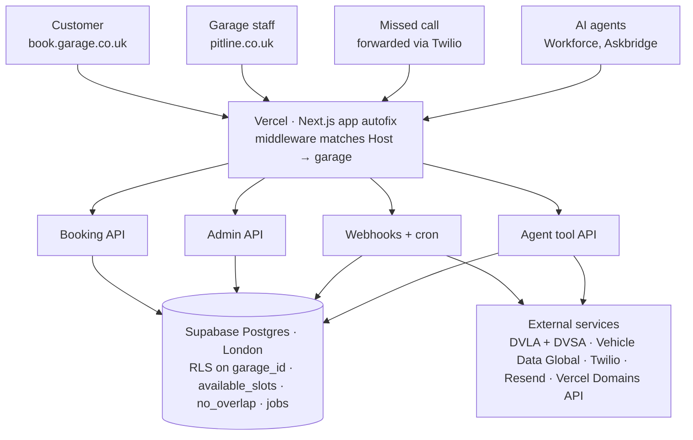

# Pitline — Backend Engine Spec

Version 1 · 25 Oct 2026 · Owner: Temitope Agbola
Live doc (comments, edits): https://claude.ai/artifact/VyDyF3gpqZk5CdeFBMCDjA. If the two differ, the live doc wins; update this file to match.

## Summary and decisions

Pitline runs as one Next.js app on Vercel and one Supabase Postgres database in London, serving every garage. It is forked from SOB Autofix, so the booking flow, admin, invoicing and email code start out already tested. The biggest change is replacing Cal.com with a scheduling engine of our own, so each garage's diary lives in our database.

| Area | Decision | Why |
| --- | --- | --- |
| Codebase | Fork `Isaacpyo/sobautofix` into a new `autofix` repo; keep Next.js 16, React 19, Supabase, Resend, zod, Sentry. Remove SOB-only content (articles, gallery, SEO landing pages) | Booking wizard, admin shell, MFA, invoicing and vehicle lookup are already built and tested |
| Hosting | Vercel project `autofix` in the Vitalos team, on `pitline.co.uk` and `*.pitline.co.uk` | DNS records went live on 25 Oct 2026 |
| Garage domains | Garage adds `book.theirgarage.co.uk` CNAME → `cname.vercel-dns-0.com`; the app adds the domain through the Vercel domains API; Vercel issues the certificate | No proxy layer; free on Pro, 50 domains on Hobby |
| Database | Supabase Postgres, London region, one schema, `garage_id` on every tenant row, row-level security | Same as SOB; UK data residency |
| Scheduling | Our own availability engine (bays, opening hours, service durations, buffers) | One Cal.com account per garage would not scale and splits the diary |
| Vehicle data | DVLA Vehicle Enquiry Service + DVSA MOT History API (both free, keys by application); Vehicle Data Global kept as paid fallback | MOT expiry dates drive the reminders |
| Messaging | SMS and WhatsApp through one provider (Twilio proposed); email through Resend | Reminders, missed-call text-back, booking updates |
| AI front desk | Askbridge widget on booking pages; Workforce agent answers calls and WhatsApp through an API | Reuses Vitalos products instead of building new AI |
| Background jobs | Vercel Cron triggers + a Postgres job queue | Reminder sends, nightly MOT refresh, retries |
| MOT | Per-garage switch (SOB bans MOT by client rule; the platform must not) | MOT reminders are the main paid feature |

## Architecture overview



Every caller hits the same Vercel app. The host name decides which garage and which surface, and all state lives in one London Postgres with row-level security.

## Multi-tenancy and domains

Every request is matched to a garage by its host name before anything renders, and the client never sends a garage ID. Next.js middleware (`proxy.ts` in Next 16; check `node_modules/next/dist/docs/`) reads the `Host` header and rewrites to an internal route:

| Host | Serves | Rewrite |
| --- | --- | --- |
| `pitline.co.uk` | Garage admin, sign-up, super admin | `/app/…`, `/admin/…` |
| `<slug>.pitline.co.uk` | That garage's booking site (free link) | `/_site/<garageId>/…` |
| Any other verified host, e.g. `book.theirgarage.co.uk` | That garage's booking site | `/_site/<garageId>/…` |
| `localhost:3000` (dev) | Admin; `?__garage=<slug>` or `<slug>.localhost:3000` for booking sites (dev only) | as above |
| Unknown host | 404 page | none |

The host-to-garage map is read from `garage_domains` and cached for 60 seconds at the edge.

**Garage domain flow**

1. The garage enters `book.theirgarage.co.uk` in Booking page settings.
2. Server calls Vercel `POST /v10/projects/{projectId}/domains` and stores the row as `pending_dns`.
3. A job polls the domain config endpoint every 5 minutes for 48 hours: `pending_dns` → `verifying` → `active`, or `failed` with the reason shown in the admin.
4. On cancellation the domain is removed from the project and the row is soft-deleted.

Vercel limits domain additions to 100 an hour per team, so additions go through the job queue. Server-only env: `VERCEL_API_TOKEN` (team-scoped), `VERCEL_PROJECT_ID`, `VERCEL_TEAM_ID`.

**`/book` on the garage's existing site** is a redirect or an embed. The embed route sends a `frame-ancestors` header listing only that garage's own domains.

**Isolation**

- Every tenant table has `garage_id uuid not null` and row-level security.
- Staff access comes from `garage_members (user_id, garage_id, role)`, with roles `owner`, `manager` and `technician`.
- Public booking writes go through server routes that set `garage_id` from the host match, never from the request body.
- Vitalos staff use a separate `platform_admins` table and super-admin routes, with every action logged.
- Tests prove that a member of garage A gets zero rows from garage B for every table.

## Data model

SOB's tables are reused with `garage_id` added. The Cal.com `provider_*` columns are dropped, and five new groups are added: garages, resources, services, reminders and the job queue. Money is stored in pence, times in `timestamptz`, and phone numbers in E.164 format.

| Table | Key columns | Notes |
| --- | --- | --- |
| `garages` | `slug`, `name`, `phone`, `whatsapp`, `address`, `timezone`, `logo_url`, `accent`, `plan`, `mot_enabled`, `booking_prefix`, `slot_step_min`, `approve_online`, `service_area[]`, `status` | One row per tenant; `slug` gives the free link |
| `garage_domains` | `garage_id`, `hostname` (unique), `kind` subdomain/custom, `status`, `last_checked_at`, `error` | Status: `pending_dns`, `verifying`, `active`, `failed` |
| `garage_members` | `user_id`, `garage_id`, `role` | Supabase Auth users; MFA tables carried over from SOB |
| `platform_admins` | `user_id` | Vitalos staff |
| `customers` | `garage_id`, `name`, `mobile`, `email`, `channel`, `reminder_consent`, `consent_at`, `consent_source`, `opted_out_at` | Unique on (`garage_id`, `mobile`) |
| `vehicles` | `garage_id`, `customer_id`, `registration`, `make`, `model`, `colour`, `fuel`, `year`, `mot_expiry`, `mot_checked_at`, `last_mileage`, `last_service_at` | Registration stored normalised (no spaces, upper case) |
| `vehicle_facts` | `reg_hash`, `facts jsonb`, `fetched_at` | Platform-wide 24 h lookup cache, no customer data |
| `resources` | `garage_id`, `name`, `kind` bay/mobile/technician, `active`, `sort` | What a booking takes up |
| `opening_hours`, `closures` | `weekday`, `opens`, `closes`; date ranges | Per garage |
| `services` | `garage_id`, `name`, `description`, `duration_min`, `buffer_min`, `price_pence`, `price_mode` fixed/from/quote, `location_mode`, `resource_kind`, `online_enabled`, `needs_approval`, `min_notice_h`, `max_days_ahead`, `is_mot`, `sort` | Replaces SOB's `booking_service_types` |
| `bookings` | `garage_id`, `reference`, `customer_id`, `vehicle_id`, `service_id`, `resource_id`, `during` (tstzrange), `status`, `source`, `location_mode`, `postcode`, `symptoms`, `notes`, `idempotency_key`, `manage_token_hash`, `reminder_send_id` | Exclusion constraint blocks double-booking (below) |
| `booking_events` | `booking_id`, `type`, `actor`, `at`, `data` | Audit trail and timeline |
| `reminder_rules` | `garage_id`, `kind` mot/service/review/missed_call, `enabled`, `offset_days[]`, `channel`, `template` | Defaults seeded at sign-up |
| `reminder_sends` | `garage_id`, `rule_id`, `vehicle_id`, `customer_id`, `due_date`, `send_at`, `status`, `provider_msg_id`, `link_token`, `booking_id` | `booking_id` attributes revenue to the reminder |
| `messages`, `calls` | `garage_id`, channel, direction, body, provider IDs, `missed` flag | Inbound and outbound log |
| `agent_tokens` | `garage_id`, `token_hash`, `name`, `scopes[]`, `last_used_at` | Workforce / Askbridge access |
| `invoices`, `invoice_items` | From SOB plus `garage_id`; numbering sequence per garage | |
| `jobs` | `kind`, `payload`, `run_at`, `attempts`, `locked_until`, `status`, `last_error` | Postgres job queue (`for update skip locked`) |
| `webhook_events`, `audit_log`, `rate_limit_buckets` | From SOB (+ `garage_id`) | Idempotency, admin actions, abuse limits |

Booking statuses: `requested`, `confirmed`, `arrived`, `in_progress`, `waiting_parts`, `ready`, `collected`, `cancelled`, `no_show`. Booking sources: `online`, `phone`, `walk_in`, `reminder`, `missed_call`, `ai_agent`.

```sql
create extension if not exists btree_gist;
alter table bookings add constraint no_overlap
  exclude using gist (resource_id with =, during with &&)
  where (status not in ('cancelled', 'no_show'));
```

## Booking and availability engine

Time slots are worked out in Postgres from each garage's opening hours, bays and service lengths, and the database itself refuses double bookings. No slot holds are needed: a booking is written at confirmation, and if someone else took the time first the customer gets the nearest free times back.

**Working out free slots** (`available_slots(garage_id, service_id, from, to)`, cached for 30 seconds)

1. Build each day's open windows from `opening_hours`, minus `closures`, in the garage's time zone. Clock changes are handled by building times in `Europe/London`, not in UTC.
2. Generate start times every slot step (garage setting, 15 minutes by default) from opening until closing time minus the service length.
3. Drop starts sooner than `min_notice_h` or later than `max_days_ahead`.
4. Keep a start only if at least one active resource of the service's `resource_kind` has no live booking overlapping `[start, start + duration + buffer)`.
5. Return the times and a free count. Customers never see which bay a booking uses.

**Confirming a booking** (one transaction)

1. Match or create the customer by mobile number and the vehicle by registration, scoped to the garage.
2. Pick the least-busy free resource and insert the booking. The `no_overlap` constraint is the final check.
3. On a constraint conflict, return 409 with the three nearest free slots.
4. Status is `requested` when the service or garage requires approval, otherwise `confirmed`. Requested bookings hold their slot.
5. Write a `booking_events` row and queue the customer confirmation (SMS or WhatsApp, plus email with an `.ics` file) and the staff alert.

**Other rules**

- Mobile visits: the postcode must fall in the garage's service area (a list of postcode districts), and a travel buffer is added before and after.
- Change or cancel: booking reference plus registration (as SOB does today), or the signed link in the confirmation. The cancellation cutoff is a garage setting.
- Staff calendars: a private ICS feed per garage. Google Calendar two-way sync comes later.
- `/api/bookings` keeps SOB's idempotency key, rate limits and Turnstile check.
- SOB stays on Cal.com until Pitline is stable, then can move over as a tenant if wanted.

## Vehicle data and MOT engine

Three sources are combined behind SOB's existing `VehicleLookupProvider` interface (`src/lib/vehicle/provider.ts`). The free government APIs supply the facts and MOT dates; the paid provider fills in model and trim.

| Source | Gives | Access | Env |
| --- | --- | --- | --- |
| DVLA Vehicle Enquiry Service | Make, colour, fuel, year, tax status, MOT status and expiry | Free; API key by application | `DVLA_VES_API_KEY` |
| DVSA MOT History API | MOT expiry, test results, mileage readings, advisories | Free under the Open Government Licence; approved application issues credentials | `DVSA_MOT_CLIENT_ID`, `DVSA_MOT_CLIENT_SECRET`, `DVSA_MOT_API_KEY`, `DVSA_MOT_TOKEN_URL`, `DVSA_MOT_SCOPE` |
| Vehicle Data Global (already used by SOB) | Model and trim | Paid per lookup | `VEHICLE_DATA_GLOBAL_API_KEY` |

**Lookup at booking step 1**: a `CompositeProvider` calls DVLA and DVSA in parallel and Vehicle Data Global only when the model is missing. Results are cached for 24 hours in `vehicle_facts`, keyed by a hash of the registration, holding vehicle facts only. SOB's rule stays: registrations never go in URLs or analytics. If every source fails, the customer enters the car by hand. Keep `mock.ts` as the dev/test provider.

**SOB's MOT ban must be removed for the platform**: SOB's provider-normalisation layer discards MOT fields and `src/__tests__/content-guard.test.ts` blocks MOT content. In Pitline, MOT data flows through and is shown only when `garages.mot_enabled` is true.

**Nightly MOT refresh** (job `mot.refresh`, 02:00)

1. Select vehicles in garages with MOT switched on, where the customer has reminder consent and the MOT expiry is unknown, within 60 days, or last checked more than 30 days ago.
2. Refresh from DVSA in batches that respect its rate limit.
3. If the expiry has moved forward (MOT done elsewhere), cancel that vehicle's pending MOT reminders.
4. Write `mot_checked_at` and create or update the vehicle's `reminder_sends` rows.

**Customer import**: the garage uploads a CSV of name, mobile, email, registration and consent. Rows are validated (UK mobile, registration format) and de-duplicated, then enriched from DVSA in the background. The garage must tick a declaration that it holds consent before any reminder is scheduled.

## Reminders and messaging engine

Reminders are scheduled once a day, sent in small batches during quiet-hours-safe windows, and every booking they produce is credited back to them. That credit is the "won back" figure on the garage dashboard.

**Channels** sit behind one `MessageChannel` interface, so providers can change without touching the engine.

| Channel | Provider (proposed) | Use |
| --- | --- | --- |
| SMS | Twilio, alphanumeric sender per garage (up to 11 characters, e.g. `HartleyRd`) | Reminders, confirmations, missed-call text-back |
| WhatsApp | Twilio WhatsApp sender with Meta-approved templates | Customers who choose WhatsApp; two-way replies |
| Email | Resend (already in SOB) | Confirmations with `.ics`, receipts, invoices |

**Pipeline**

1. `reminders.schedule` (daily, 06:00): for each enabled rule, create `reminder_sends` rows for vehicles due at each offset (MOT: 28 and 7 days before expiry; service: 11 months after the last service).
2. `reminders.send` (every 10 minutes): take rows whose `send_at` has passed, but only 09:00–19:00 Monday to Saturday in the garage's time zone.
3. Re-check consent and opt-out at send time, render the garage's template, and create a short link token (30-day expiry) that opens the booking page with the car and service filled in.
4. Send, store the provider message ID, and update status from delivery webhooks: `sent`, `delivered`, `failed`.
5. A booking made through the token sets `source = reminder` and links `reminder_sends.booking_id`. Revenue counts the invoice total when one exists, otherwise the service price.

**Templates**: editable per garage with `{first_name}`, `{vehicle}`, `{reg}`, `{due_date}`, `{link}` and `{garage}`, plus a live 160-character SMS counter. Every message ends "Reply STOP to opt out".

**Opt-out**: an inbound STOP (SMS or WhatsApp) or the unsubscribe page sets `opted_out_at` straight away, and nothing more is sent to that number from that garage.

**Consent**: an unticked box at booking (design screen Book 4), an import declaration, or the existing-customer "soft opt-in" with an opt-out on every message. The wording needs a UK privacy and PECR check before launch.

Vercel Hobby allows only daily crons; every-10-minute sends need Vercel Pro (or an external scheduler hitting `/api/cron/*`).

## AI front desk and missed calls

Pitline doesn't build its own AI. It exposes a small, garage-scoped tool API that the Workforce agent (calls and WhatsApp) and Askbridge (website chat) call into. Without the Front desk plan, missed calls still get an automatic text-back.

**Missed calls**

1. The garage keeps its own number and sets "forward when busy or unanswered" to a Pitline UK number from Twilio, one per garage.
2. Twilio's voice webhook hits `/api/webhooks/twilio/voice` (garage resolved from the called number) and logs a `calls` row.
3. Growth plan: play a short message, take an optional voicemail, and send the text-back with a booking link within 60 seconds.
4. Front desk plan: hand the call to the Workforce voice agent.
5. Either way, a "Needs your OK" card appears in the admin.

**Tool API for agents** (`/api/agent/v1/*`, a service token per garage, every call logged)

| Tool | Does | Limit |
| --- | --- | --- |
| `lookup_vehicle` | Registration → make, model, MOT due | Same chain as the booking page |
| `list_services` | Names, durations, published prices | Only prices in `services`; never invents a quote |
| `available_slots` | Free times for a service and date range | Same engine as the booking page |
| `create_booking` | Makes a booking with `status = requested`, `source = ai_agent` | Staff confirm; the agent can't confirm, move or cancel |
| `get_booking` | Status by reference plus registration | Read only |
| `garage_profile` | Hours, address, policies, FAQs | Read only |

**Askbridge** sits on booking pages as the chat widget. Each garage uses its own Askbridge workspace and pastes its site key into Pitline; Askbridge learns by crawling the garage's website, and Pitline sends it nothing ([askbridge.md](askbridge.md)). Customers book through the booking flow as usual.

**Guardrails**: no diagnosis or repair advice beyond the garage's own FAQ, always offer a human callback, per-garage on/off switch, and transcripts stored in `messages`.

## API surface and webhooks

All routes are Next.js route handlers with zod-validated input. Public routes take the garage from the host name; admin routes take it from the signed-in member's selected garage.

| Route | Caller | Purpose |
| --- | --- | --- |
| `POST /api/vehicle/lookup` | Booking page | Registration → vehicle (rate-limited, Turnstile) |
| `GET /api/services` | Booking page | Online-bookable services for this garage |
| `GET /api/slots?service&from&to` | Booking page | Free times |
| `POST /api/bookings` | Booking page | Create booking (idempotency key) |
| `GET/PATCH /api/bookings/manage` | Customer | View, reschedule or cancel by reference + registration or signed token |
| `GET /r/{token}` | Customer | Reminder link → prefilled booking page |
| `/api/admin/*` | Garage staff | Diary, bookings, customers, services, hours, reminders, templates, imports, domains, branding, invoices |
| `/api/platform/*` | Vitalos super admin | Garages, plans, impersonation (logged), health |
| `/api/agent/v1/*` | Workforce, Askbridge | Tool API (section above) |
| `GET /api/cron/{job}` | Vercel Cron (`CRON_SECRET`) | Enqueues `reminders.schedule`, `reminders.send`, `mot.refresh`, `domains.check`, `retention` |
| `POST /api/webhooks/twilio/{sms,whatsapp,voice,status}` | Twilio | Inbound messages, STOP, missed calls, delivery status (signature checked) |
| `POST /api/webhooks/resend` | Resend | Email delivery events (from SOB) |
| `POST /api/webhooks/stripe` | Stripe | Subscription billing, later |
| `GET /api/ics/{garageToken}` | Staff calendars | Private diary feed |

Every webhook checks its signature against the raw body, writes `webhook_events` first for idempotency, then queues the work.

## Security, privacy and compliance

Each garage is the data controller for its own customers and Vitalos is its processor. So the product ships with a data processing agreement, UK data residency and a deletion path from day one.

- **Isolation**: row-level security on every tenant table, plus a CI test suite that tries cross-garage reads and writes on every table and expects zero.
- **Accounts**: Supabase Auth with SOB's MFA, trusted devices and recovery codes, required for owners. Sessions expire after 12 hours.
- **Secrets**: Vercel environment variables marked Sensitive and `.env.local` gitignored (as in SOB). No `NEXT_PUBLIC_` prefix on anything secret.
- **Abuse**: Turnstile and per-IP and per-garage rate limits on lookup and booking (SOB's `rate_limit_buckets`). Agent tokens are scoped to one garage.
- **Personal data**: registrations kept out of URLs and analytics; mobile numbers masked in customer-facing pages; booking management tokens stored only as hashes.
- **Retention**: cancelled or no-show bookings anonymised after 24 months, message bodies after 12 months, and a garage's whole data set deleted 30 days after it cancels (export offered first). This extends SOB's `cron/retention`.
- **Messaging law**: consent capture, STOP handling and quiet hours as in the reminders section. PECR and privacy wording reviewed before the first paying garage.
- **Observability**: Sentry (from SOB), structured logs with `garage_id` on every line, an uptime check on booking and slot routes, and an alert when the job queue backlog passes 15 minutes.
- **Backups**: Supabase daily backups plus point-in-time recovery on the paid tier. Quarterly restore rehearsal.

## Build plan

See `docs/autofix/BUILD-PLAN.md` for the task-level plan. Summary:

| Phase | Days | Delivers | Gate (must pass in CI) |
| --- | --- | --- | --- |
| 1 Fork + tenancy | 1–3 | Fork SOB, new repo; schema, RLS, tests; host routing; Vercel domains API | Cross-garage tests return zero rows |
| 2 Booking engine | 4–7 | `available_slots()`; booking + manage API; 5-step booking UI; confirmations | 100 parallel bookings, zero double-booked |
| 3 Admin + reminders | 8–11 | Today, diary, services; DVLA + DVSA lookups; reminder pipeline; CSV import | Reminder link booking credited end to end |
| 4 Front desk + launch | 12–14 | Missed-call text-back; agent tool API; domain setup UI; first garage onboarded | First garage live on its own domain |

## Open decisions

See `docs/autofix/DECISIONS.md`.
